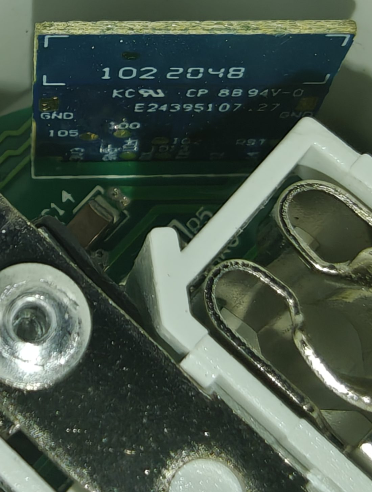
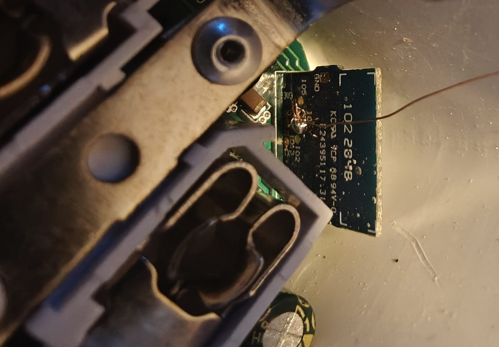
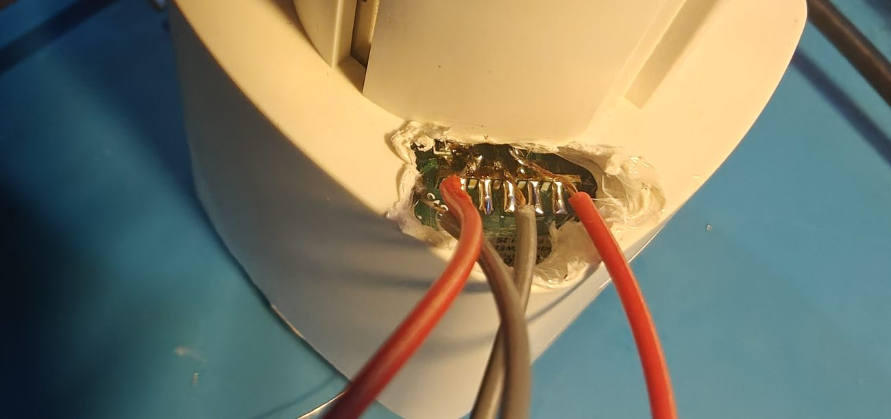

# EZVIZ T30 → Tasmota (local, no cloud)

Flash the **EZVIZ T30** Wi‑Fi smart plug (a rebranded **Tuya WG08**) with **Tasmota** for
fully local control via **MQTT / Home Assistant** — no cloud, no app account.

The plug's Wi‑Fi module is a **TYWE2S** (Tuya module based on the **ESP8285**, 1 MB flash),
so it is fully reflashable over serial. This repo documents the exact wiring, flashing
procedure, GPIO mapping and the traps I hit, so you don't have to rediscover them.

> Board markings on my unit: `102 2048 / KC CP 8B 94V-0 / E243951 07.27`
> Tested on a **CS‑T30 10A EU (WG08(10) v1.4)** with **Tasmota 15.5**.



*The TYWE2S (ESP8285) module sitting in the plug — you can see the `IO5 / IO0 / IO2 / RST / GND` pads used for flashing.*

---

## ⚠️ Safety first (read this)

- This device runs on **mains voltage (110–230 V AC)**. Flashing is done **module powered by 3.3 V from a USB‑UART adapter, NEVER while connected to mains.** Never have mains and the FTDI connected at the same time.
- The T30 is **very hard to open without damaging the housing** (the socket pins are moulded into the plastic). You usually pry the top cover and work on the module in place.
- **The internal PSU is fragile.** On one of my units the mains→3.3 V supply died after rework (it only produced ~0.3 V at the module, endless brown‑out reset). If the module works on the FTDI but not on mains, and you measure well under 3.3 V at the module's `3V3` pin on mains → the PSU is dead, the plug is scrap (the ESP is fine and reusable).
- Do this **at your own risk.** If you're not comfortable with mains, don't.

---

## What you need

- USB‑UART (FTDI/CP2102/CH340) adapter switchable to **3.3 V logic** (set the jumper to 3.3 V!)
- Thin wires + soldering iron
- `esptool` and (for config) `paho-mqtt`:
  ```bash
  pip install --user esptool paho-mqtt
  ```
- The Tasmota binary: `tasmota.bin` from <https://ota.tasmota.com/tasmota/release/tasmota.bin>

---

## 1. Wiring (TYWE2S ↔ USB‑UART)

The TYWE2S has castellated pads. You only need 5 for flashing:

```
USB-UART            TYWE2S module
--------            -------------
3V3      ───────►   3V3     (power, 3.3 V ONLY)
GND      ───────►   GND
TX       ───────►   RX      (crossed!)
RX       ───────►   TX      (crossed!)
                    IO0 ──► GND   (only to enter bootloader, see below)
```

TYWE2S pad layout (from the silkscreen):
- bottom row: `3V3 · GND · RX · IO4 · TX · GPIO12 · GPIO14`
- top / side: `IO5 · IO0 · IO2 · IO13 · RST` + `GND` pads in the corners


*The module lifted out — solder your wires to the `3V3 / GND / RX / TX` pads (and `IO0` for bootloader).*


*Flashing in place: FTDI wires soldered directly to the module pads without fully extracting the board.*

**Enter bootloader / flash mode:** connect **IO0 to GND**, then power‑cycle the module
(cut and restore 3V3). It boots into the UART download ROM. Keep IO0 on GND during flashing.

> USB‑UART auto‑reset usually is NOT wired to this module, so esptool must be told not to
> reset — use `--before no-reset` and enter the bootloader manually as above.

---

## 2. Flash Tasmota

The ESP8285 requires **DOUT** flash mode.

```bash
# 1) (optional but recommended) back up the original firmware
python -m esptool --port COMx --baud 115200 --before no-reset --after no-reset \
  read-flash 0x0 0x100000 stock-backup.bin

# 2) erase + write Tasmota
python -m esptool --port COMx --baud 115200 --before no-reset --after no-reset erase-flash
python -m esptool --port COMx --baud 115200 --before no-reset --after no-reset \
  write-flash --flash-mode dout --flash-size 1MB 0x0 tasmota.bin
```

(Replace `COMx` with your serial port, e.g. `COM3` or `/dev/ttyUSB0`.)

Then **remove IO0 from GND** and power‑cycle → Tasmota boots and starts its Wi‑Fi setup AP
(`tasmota-XXXX`, `192.168.4.1`). You can configure from there, or over serial/MQTT (below).

---

## 3. GPIO mapping (the important part)

Found pad‑by‑pad on my unit. **Verify on yours** (revisions vary) with the discovery method below.

| GPIO  | Function            | Tasmota component |
|-------|---------------------|-------------------|
| GPIO12| Relay               | `Relay1` (224)    |
| GPIO13| Button              | `Button1` (32)    |
| GPIO5 | Red LED (relay state, active‑low) | `Led_i1` (320) |
| GPIO4 | Blue LED (Wi‑Fi status) | `LedLink` (544) |

Apply it (Tasmota console or `cmnd/<topic>/Backlog`):

```
Module 18
GPIO12 224
GPIO13 32
GPIO4 544
GPIO5 320
```

### Discover the mapping yourself (if your revision differs)

- **Relay:** set a candidate to `Relay1` and toggle `Power` — the relay clicks (audible even
  on the bench at 3.3 V, the coil driver signal toggles).
- **LEDs:** set a candidate to `Relay1..N` and toggle — watch which LED reacts. Active‑low LED → use `Led_i`.
- **Button:** set candidates as detached buttons (`SetOption73 1`, then `GPIOxx 32/33/34…`)
  and watch `stat/<topic>/RESULT` for `{"ButtonN":{"Action":"SINGLE"}}` when you press.
  Or use pulse `Counter` on candidates and read the counts after pressing.

---

## 4. Configuration (Wi‑Fi + MQTT + sane defaults)

Fill in your values, then paste into the Tasmota console (or use `configure.py`):

```
Backlog SSID1 YOUR_WIFI_SSID; Password1 YOUR_WIFI_PASSWORD; \
  MqttHost YOUR_MQTT_BROKER_IP; MqttPort 1883; \
  Topic ezviz-t30; DeviceName EZVIZ T30; FriendlyName1 EZVIZ T30; \
  PowerOnState 0; SetOption65 1
Backlog Module 18; GPIO12 224; GPIO13 32; GPIO4 544; GPIO5 320
```

- **`SetOption65 1`** — disables Tasmota's "fast power‑cycle reset". **Set this!** Otherwise a
  few quick mains power‑cycles wipe your Wi‑Fi/config. This bit me repeatedly.
- **`PowerOnState 0`** — relay OFF on boot (safe default).
- `SetOption1 0` (default) keeps the native **6‑press → Wi‑Fi Manager** recovery (see below).

---

## 5. Home Assistant discovery

On recent Tasmota, `SetOption19 1` publishes to `tasmota/discovery/…` (needs the **Tasmota**
HA integration). If you only use the plain **MQTT** integration, publish a standard discovery
config yourself (retained). Example payload to `homeassistant/switch/ezviz-t30/config`:

```json
{
  "name": "EZVIZ T30",
  "unique_id": "ezviz_t30_relay",
  "command_topic": "cmnd/ezviz-t30/POWER",
  "state_topic": "stat/ezviz-t30/POWER",
  "payload_on": "ON", "payload_off": "OFF",
  "availability_topic": "tele/ezviz-t30/LWT",
  "payload_available": "Online", "payload_not_available": "Offline",
  "device": { "identifiers": ["ezviz-t30"], "name": "EZVIZ T30",
              "model": "EZVIZ T30 (Tasmota / ESP8285)", "manufacturer": "EZVIZ" }
}
```

---

## 6. Recovery without serial (no need to re‑open the plug)

- **6 short presses** on the button → starts the **Wi‑Fi Manager** AP (`192.168.4.1`) to
  reconfigure Wi‑Fi. Keeps your template/MQTT config. (This is native Tasmota, `SetOption1 0`.)
- If the plug **loses Wi‑Fi** (you change your router, etc.) it opens that AP **automatically**.
- The MQTT/relay/button config is **preserved** across a Wi‑Fi reconfig — nothing else to redo.

---

## Gotchas & lessons learned (save yourself the pain)

- ⛔ **Never** configure **GPIO0** as an input/counter/button. It's the boot‑strapping pin —
  if it's low at boot the ESP enters the UART bootloader instead of Tasmota (silent, offline).
  Recover with `Reset 1` over serial, or tie GPIO0 → 3V3 at power‑up to force a normal boot.
- **GPIO9 / GPIO10** are used by the internal flash → not available as GPIOs.
- **GPIO16** has no interrupt → **cannot be a `Counter`** (works as a polled button only).
- **GPIO2 / GPIO15** are strapping pins → avoid as floating inputs.
- **GPIO1 (TX) / GPIO3 (RX)** work as GPIO but kill the serial console; if the FTDI is wired
  to them it will mask a button connected there. Disconnect FTDI data lines to test them.
- Repeated **hardware power‑cycles reset the config** unless `SetOption65 1` is set. Prefer
  `Restart 1` (soft) while bench‑testing.
- The button on this plug does **not** do a clean long‑hold or fast multi‑press reliably —
  only single presses. Use single‑press = toggle + the native 6‑press Wi‑Fi Manager.
- **Don't reinvent recovery with rules** — the 6‑press Wi‑Fi Manager and `SetOption65` are built in.

### Tasmota component codes (handy)
`None=0`, `Button1=32`, `Relay1=224`, `Led1=288`, `Led_i1=320`, `Counter1=352`, `LedLink=544`, `LedLink_i=576`.

---

## Files

- [`configure.py`](configure.py) — flash + serial‑configure helper (edit the CONFIG block first).

## License

[MIT](LICENSE) © calaxo — you can reuse, modify and redistribute this work (including commercially)
as long as you keep the copyright and license notice. A link back to this repository is appreciated.
Provided as‑is; mains voltage work is at your own risk.
